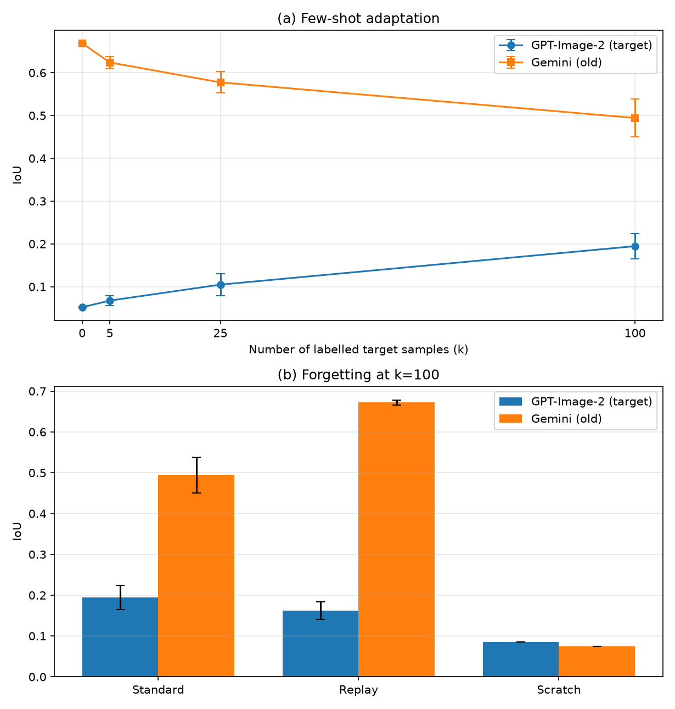
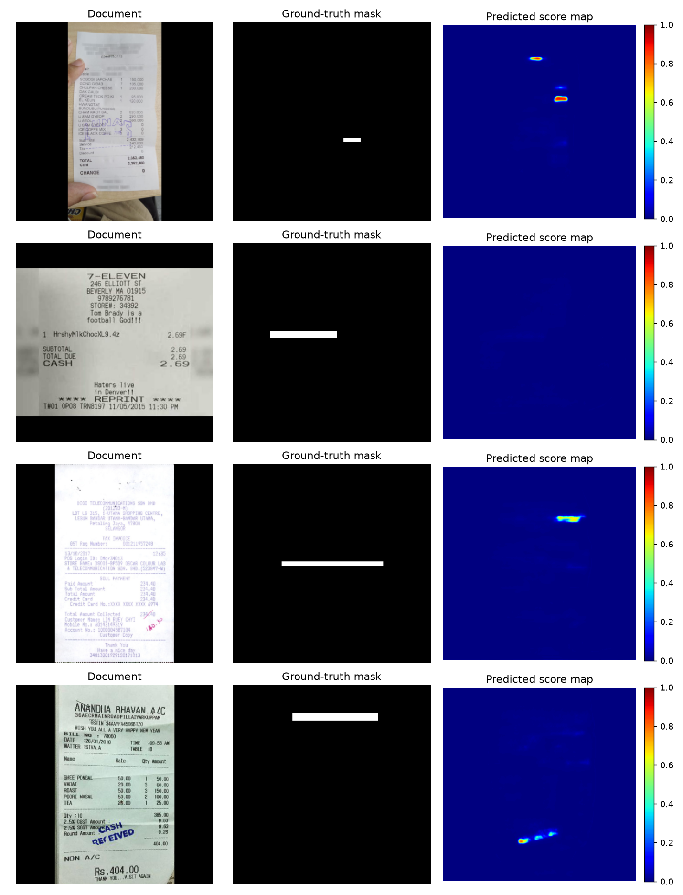
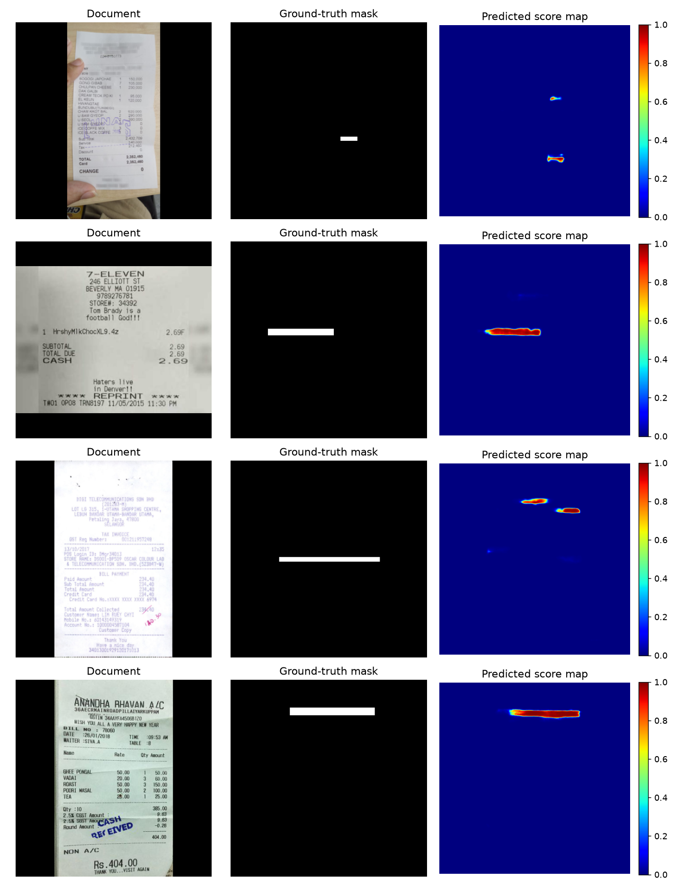
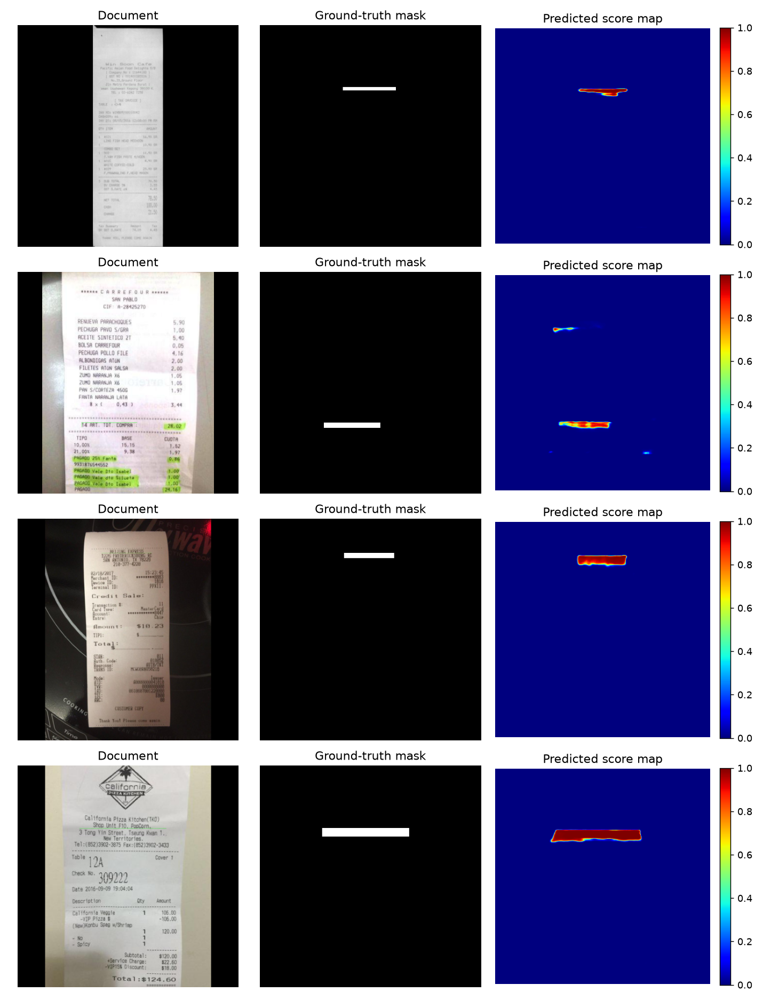
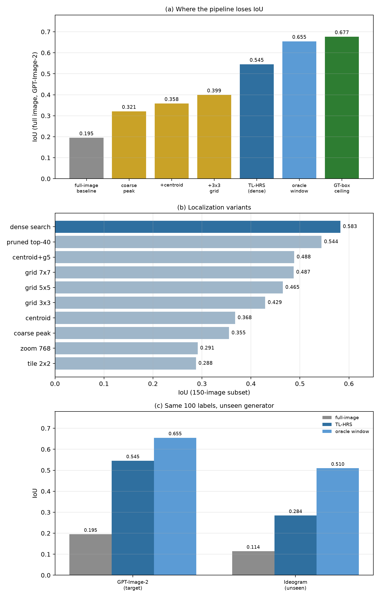

# Thích ứng tiết kiệm nhãn cho hệ thống phát hiện giấy tờ tài chính bị AI sửa dưới dịch chuyển bộ sinh, bằng rehearsal và tìm kiếm dày độ phân giải cao

**Tác giả:** Bản ẩn danh (giữ kín tên cho phản biện).

---

## Tóm tắt

Các công cụ sinh ảnh có thể sửa một trường số trên hóa đơn tài chính trong chưa đầy một giây, trong khi các detector huấn luyện trên giả mạo truyền thống (ví dụ Photoshop) gần như không phát hiện được. Ngay cả một detector huấn luyện trên một bộ sinh inpainting cũng sụp đổ khi bộ sinh thay đổi — hiện tượng *dịch chuyển bộ sinh* (generator shift). Trong triển khai ngân hàng thực tế, việc thu thập nhiều mẫu giả mạo có nhãn cho từng bộ sinh mới là không khả thi. Chúng tôi nghiên cứu **thích ứng tiết kiệm nhãn** cho detector giấy tờ bị AI sửa dưới dịch chuyển bộ sinh, và đặt câu hỏi liệu một lượng nhỏ mẫu có nhãn từ bộ sinh mới có đủ để khôi phục năng lực định vị mà không quên hoàn toàn các bộ sinh cũ hay không. Trên benchmark AIForge-Doc (Gemini, Ideogram, GPT-Image-2), chúng tôi chỉ ra rằng: (i) detector huấn luyện trên Gemini sụp đổ trên bộ sinh chưa thấy (IoU 0.052 trên GPT-Image-2); (ii) fine-tune few-shot khôi phục định vị một cách đơn điệu, đạt IoU 0.195 ± 0.037 với chỉ 100 mẫu đích có nhãn (≈3.7× so với zero-shot); (iii) train from scratch với cùng 100 nhãn kém hơn đáng kể (IoU 0.085), cho thấy pretrain trên bộ sinh gốc quan trọng; và (iv) rehearsal 100 mẫu từ bộ sinh cũ khôi phục hiệu năng in-domain về 0.672 ± 0.006 (gần mức zero-shot 0.669) với chi phí nhỏ trên bộ sinh đích (IoU 0.162). Chúng tôi cũng báo cáo một loạt kết quả âm: temperature scaling, hiệu chỉnh ngưỡng toàn cục và theo ảnh, chiến lược chọn mẫu, đóng băng encoder, kênh tần số và phát hiện bất thường tổng quát **không** mang lại cải thiện ổn định. Phân tích cho thấy nút thắt là **độ chính xác định vị**, không phải hiệu chỉnh ngưỡng quyết định.

Cuối cùng, chúng tôi chỉ ra rằng việc thích ứng một bộ phân đoạn patch ở độ phân giải gốc với cùng 100 nhãn nâng trần định vị từ 0.459 lên 0.677 IoU, nhưng **đỉnh coarse dùng để đặt crop lại chính là nút thắt**: nó lệch tâm trường 152 px (trung vị), khiến crop chỉ phủ 53% điểm ảnh bị sửa. Thay đỉnh đơn bằng **tìm kiếm dày độ phân giải cao** trên các cửa sổ 384 px và chọn theo độ tin cậy của patch đạt **0.545 ± 0.012 IoU trên bộ sinh chưa thấy đầy đủ (2.8× baseline toàn ảnh, 82% trần)**, và 0.284 IoU trên một bộ sinh hoàn toàn chưa thấy (Ideogram) so với 0.114 của detector toàn ảnh. Nghiên cứu định vị cho thấy các biến thể centroid, lưới, zoom và tile đều kém hơn tìm kiếm dày; bản đồ coarse không đủ tin cậy để pruning; và khoảng cách còn lại là vấn đề **hiệu chỉnh độ tin cậy khi chọn cửa sổ** dưới dịch chuyển bộ sinh (IoU oracle-window là 0.653). Chúng tôi công bố mã nguồn, split và toàn bộ kết quả để tái lập.

---

## 1. Mở đầu

Gian lận tài liệu số đang gia tăng nhanh chóng. Các API inpainting sinh ảnh gần đây có thể thay một con số hoặc một ngày trên ảnh chụp hóa đơn trong khi vẫn giữ font, màu và kết cấu, không để lại dấu vết nén hay copy-move rõ ràng. Vì vậy, các detector thiết kế cho giả mạo tài liệu truyền thống suy giảm mạnh trên loại giả mạo này.

Một vấn đề thứ hai, ít được thảo luận hơn, là **dịch chuyển bộ sinh**. Một detector huấn luyện trên giả mạo do một mô hình inpainting tạo ra sẽ học các dấu vết đặc thù của bộ sinh đó thay vì một khái niệm giả mạo không phụ thuộc bộ sinh. Khi một bộ sinh mới xuất hiện, detector sụp đổ. Trong ngân hàng, điều này mang tính vận hành sống còn: tổ chức không thể chờ thu thập hàng nghìn mẫu giả mạo có nhãn cho mỗi công cụ mới.

Vì vậy chúng tôi nghiên cứu câu hỏi thực tiễn:

> *Cho một detector huấn luyện trên bộ sinh cũ, cần bao nhiêu mẫu có nhãn từ bộ sinh mới để khôi phục định vị, và làm sao thích ứng mà không quên bộ sinh cũ?*

Chúng tôi dùng benchmark AIForge-Doc, cung cấp các tài liệu tài chính và biểu mẫu bị inpainting bởi AI với mask chính xác đến từng điểm ảnh cho ba họ bộ sinh: Gemini 2.5 Flash Image, Ideogram v2 Edit và GPT-Image-2. Chúng tôi áp dụng giao thức leave-one-generator-out và đánh giá cả định vị (IoU/F1/Dice) lẫn các chỉ số hướng phát hiện (image AUC/AP, Recall@1%FPR).

**Đóng góp.**
1. Một nghiên cứu có kiểm soát về thích ứng tiết kiệm nhãn cho phát hiện giấy tờ bị AI sửa dưới dịch chuyển bộ sinh.
2. Đường cong thích ứng few-shot (k = 0, 5, 25, 100; 3 seed) cho thấy khôi phục đơn điệu (IoU 0.052 -> 0.195 ± 0.037).
3. Một chiến lược rehearsal khôi phục hiệu năng bộ sinh cũ về gần mức zero-shot (Gemini IoU 0.672 ± 0.006) trong khi vẫn giữ phần lớn lợi ích thích ứng.
4. Một bộ kết quả âm trung thực: calibration, ngưỡng thích ứng, chọn mẫu, đóng băng encoder, kênh tần số và phát hiện bất thường tổng quát không mang lại cải thiện ổn định; chúng tôi phân tích lý do.
5. Bằng chứng định tính (bản đồ điểm) cho thấy thích ứng làm sắc nét định vị chứ không chỉ dịch ngưỡng.
6. Một **phương pháp tìm kiếm độ phân giải cao định vị theo văn bản (TL-HRS)** thích ứng bộ phân đoạn patch với đúng 100 nhãn đích và tìm kiếm dày trên tài liệu ở độ phân giải gốc: trần định vị tăng từ 0.459 lên 0.677, và pipeline tự động đạt **0.545 ± 0.012 IoU** trên bộ sinh chưa thấy đầy đủ (2.8× baseline toàn ảnh, 82% trần), trong khi một đỉnh coarse đơn chỉ đạt 0.321.
7. Một nghiên cứu định vị cho thấy tầng coarse, không phải phân đoạn, là nút thắt (sai số đỉnh trung vị 152 px; độ phủ crop 53% so với 98% tại box thật), và tìm kiếm dày vượt qua tinh chỉnh centroid, lưới, zoom, tile, pruning dẫn hướng bởi coarse, chọn theo OCR, fusion đa tín hiệu và gating điểm ảnh; khoảng cách còn lại là độ tin cậy chọn cửa sổ chưa hiệu chỉnh dưới dịch chuyển bộ sinh.

---

## 2. Công trình liên quan

**Phát hiện giấy tờ bị AI sửa.** DocTamper giới thiệu một benchmark giả mạo tài liệu lớn và một detector chuyên cho tài liệu dựa trên loss miền tần số. TruFor kết hợp backbone transformer với dấu vân tay nhiễu để định vị giả mạo ảnh tổng quát. AIForge-Doc và DOCFORGE-BENCH gần đây chỉ ra rằng các detector này suy giảm nghiêm trọng trên tài liệu inpainting bằng diffusion, và bài toán vẫn chưa được giải. Công trình của chúng tôi xây trực tiếp trên AIForge-Doc và nghiên cứu thích ứng thay vì phát hiện zero-shot.

**Few-shot và thích ứng miền.** Few-shot learning và thích ứng miền không giám sát là các lĩnh vực đã trưởng thành. Chúng tôi không đề xuất thuật toán thích ứng mới; thay vào đó, chúng tôi mô tả hành vi của fine-tune chuẩn trong chế độ cực kỳ khan hiếm nhãn và dịch chuyển bộ sinh, đồng thời xác định thành phần nào (pretrain, rehearsal, calibration) thực sự quan trọng.

**Học liên tục và rehearsal.** Rehearsal (experience replay) là biện pháp cổ điển chống quên thảm khốc. Chúng tôi chỉ ra rằng một buffer replay nhỏ các mẫu bộ sinh cũ đủ để giữ hiệu năng in-domain trong khi thích ứng với bộ sinh mới.

**Calibration.** Temperature scaling là phương pháp hiệu chỉnh hậu định chuẩn. Chúng tôi thấy rằng dù nó thay đổi độ tin cậy, nó không thay đổi thứ hạng và do đó không cải thiện IoU; hiệu chỉnh ngưỡng toàn cục và theo ảnh mang tính đặc thù bộ sinh và không chuyển giao ổn định.

---

## 3. Dữ liệu và giao thức

### 3.1 Dữ liệu

Chúng tôi dùng **AIForge-Doc** (v1 và v2):

| Split | Giả mạo | Thật | Bộ sinh |
|---|---|---|---|
| v1 train | 3,249 | 3,249 | Gemini (2,912), Ideogram (337) |
| v1 test | 812 | 812 | Gemini (727), Ideogram (85) |
| v2 train | 2,453 | 2,453 | GPT-Image-2 |
| v2 test | 613 | 613 | GPT-Image-2 |

v1 và v2 ghép mỗi tài liệu giả mạo với một ảnh thật tương ứng, nên số lượng ảnh thật bằng số ảnh giả mạo (ảnh thật v2 được dùng cho thích ứng và đánh giá mức ảnh). Tài liệu là hóa đơn và biểu mẫu; giả mạo thay một trường số duy nhất. Diện tích bị sửa trung vị ≈1% ảnh. Mask nhị phân (0/255). Chúng tôi kiểm tra tính toàn vẹn của toàn bộ 18,315 tệp (0 hỏng) và xác nhận căn chỉnh mask bằng mắt.

### 3.2 Giao thức leave-one-generator-out

Chúng tôi định nghĩa ba thiết lập:

- **P1 (dịch chuyển zero-shot):** train trên Gemini, test trên Gemini (in-domain), Ideogram và GPT-Image-2.
- **P2:** train trên Gemini + Ideogram, test trên GPT-Image-2 (chưa thấy).
- **P3:** train trên Gemini + GPT-Image-2, test trên Ideogram (chưa thấy).

Trừ khi nói khác, detector gốc được train trên Gemini (2,912 giả mạo + 2,912 thật).

### 3.3 Độ đo

- **Định vị:** IoU, F1, Dice tại ngưỡng 0.5.
- **Xếp hạng:** pixel AUC (trung bình theo ảnh) và image AUC.
- **Phát hiện dưới ngân sách cảnh báo:** image Average Precision (AP) và Recall tại FPR = 1% (Recall@1%FPR), phản ánh năng lực duyệt hạn chế của ngân hàng.

---

## 4. Phương pháp

### 4.1 Detector gốc

Chúng tôi dùng U-Net với encoder ResNet-18 pretrain ImageNet. Mô hình xuất một bản đồ logit một kênh. Nó được train trên Gemini với:

<i>L</i> = BCEWithLogits(<i>ŷ</i>, <i>y</i>; <i>w</i> = 20) + <i>L</i>Dice

trong đó trọng số dương bù cho mất cân bằng điểm ảnh cực lớn (≈1% bị sửa). Đầu vào được letterbox về 384×384 để giữ tỉ lệ khung tài liệu. Train bằng AdamW (lr 10−4) trong 10 epoch.

### 4.2 Thích ứng few-shot

Cho <i>k</i> mẫu có nhãn từ bộ sinh đích (cộng <i>k</i> mẫu thật), chúng tôi fine-tune detector gốc 10 epoch với cùng loss và optimizer. Mọi mô hình được đánh giá trên split test đích rời rạc.

### 4.3 Rehearsal

Để giảm quên, chúng tôi thêm <i>r</i> mẫu từ bộ sinh cũ (Gemini) vào tập fine-tune. Chúng tôi so sánh replay ngẫu nhiên với hai bộ chọn có thông tin: **hard** (BCE theo mẫu cao nhất dưới mô hình gốc) và **uncertainty** (entropy dự đoán cao nhất).

### 4.4 Calibration (nghiên cứu như ablation)

Chúng tôi nghiên cứu ba chiến lược calibration: temperature scaling khớp trên một phần mẫu đích có nhãn giữ riêng; tối ưu ngưỡng toàn cục; và ngưỡng thích ứng theo ảnh (giữ top-<i>p</i>% điểm ảnh). Các phương pháp này được đánh giá nhưng, như trình bày ở Mục 6.5, không mang lại cải thiện ổn định.

### 4.5 Tìm kiếm độ phân giải cao định vị theo văn bản (TL-HRS)

Suy luận toàn ảnh chạy ở 384×384 letterbox, nơi trường bị sửa trung vị (≈148 px rộng) chỉ chiếm vài điểm ảnh; mask thu được không chính xác về không gian. TL-HRS thêm một tầng độ phân giải gốc lên trên detector đã thích ứng.

**Thích ứng patch.** Một bộ phân đoạn patch (cùng U-Net, áp lên crop 384×384 ở tỉ lệ gốc) được fine-tune với đúng <i>k</i> nhãn đích: <i>k</i> crop quanh trường thật, <i>k</i> mẫu âm cùng dòng không chồng lấn, <i>k</i> crop ảnh thật, cộng <i>r</i> crop replay từ bộ sinh cũ. Box của crop được suy ra từ mask huấn luyện bằng connected components, nên không cần gán nhãn thêm. Cụ thể, với crop <i>x</i><i>w</i> đặt tại cửa sổ <i>w</i>, mô hình xuất logit <i>f</i>&theta;(<i>x</i><i>w</i>) và xác suất <i>ŷ</i><i>w</i> = &sigma;(<i>f</i>&theta;(<i>x</i><i>w</i>)).

**Tìm kiếm dày.** Khi suy luận, chúng tôi trượt crop trên tài liệu với stride <i>s</i> và chấm điểm từng cửa sổ bằng trung bình 1% điểm ảnh cao nhất,

<i>S</i>(<i>w</i>) = (1 / |<i>P</i>1%(<i>w</i>)|) &Sigma;<i>p</i> &isin; <i>P</i>1%(<i>w</i>) <i>ŷ</i><i>w</i>(<i>p</i>), &nbsp;&nbsp; <i>w</i>* = arg max<i>w</i> &isin; <i>W</i> <i>S</i>(<i>w</i>)

trong đó <i>P</i>1%(<i>w</i>) là tập 1% điểm ảnh có xác suất cao nhất trong cửa sổ <i>w</i> và <i>W</i> là tập cửa sổ hợp lệ (stride <i>s</i> = 96, ≈197 cửa sổ mỗi tài liệu giả mạo). Dự đoán là bản đồ xác suất patch được ngưỡng hoá tại <i>w</i>*; không dùng OCR, selector, gating hay fusion đa tỉ lệ. Trung bình top 1% bền với diện tích nền lớn và ưu tiên cửa sổ chứa mask sắc nét, độ tin cậy cao thay vì một đám mờ lớn độ tin cậy thấp. Toàn bộ pipeline thân thiện với xử lý offline (≈20 s mỗi tài liệu trên một GPU tiêu dùng) và được đánh giá đầu-cuối ở Mục 6.8.

---

## 5. Thiết lập thí nghiệm

- **Train gốc:** split train Gemini, 384×384, 10 epoch.
- **Thích ứng:** <i>k</i> &isin; {5, 25, 100} mẫu giả mạo + <i>k</i> mẫu thật đích, 10 epoch.
- **Rehearsal:** <i>r</i> = 100 mẫu bộ sinh cũ.
- **Seed:** 3 seed cho đường cong thích ứng, 4 cho rehearsal.
- **Phần cứng:** một GPU NVIDIA RTX 5060 Laptop (8 GB).
- **Tái lập:** split, seed và script cố định được công bố.

## 6. Kết quả

### 6.1 Detector zero-shot sụp đổ dưới dịch chuyển bộ sinh

| Tập test | IoU | F1 | Dice | Image AUC | Image AP | Recall@1%FPR |
|---|---|---|---|---|---|---|
| Gemini (in-domain) | 0.669 | 0.802 | 0.719 | 0.913 | 0.925 | 0.553 |
| Ideogram (chưa thấy) | 0.098 | 0.179 | 0.109 | 0.559 | 0.559 | 0.038 |
| GPT-Image-2 (chưa thấy) | 0.052 | 0.099 | 0.104 | 0.526 | 0.547 | 0.015 |

Detector train trên Gemini đạt định vị in-domain tốt nhưng sụp đổ trên bộ sinh chưa thấy. Đáng chú ý, trên GPT-Image-2 **AUC mức ảnh** gần mức ngẫu nhiên, nhưng **pixel AUC vẫn 0.899** (Mục 6.5). Nói cách khác, mô hình vẫn xếp hạng điểm ảnh bị sửa cao hơn nền, nhưng mask dự đoán không chính xác về không gian. Các điểm mức ảnh (trung bình xác suất top-1%) xác nhận bức tranh tương tự: Recall@1%FPR giảm từ 0.553 in-domain xuống 0.015 trên GPT-Image-2, nghĩa là một ngân hàng vận hành với ngân sách cảnh báo 1% sẽ bỏ sót gần như mọi giả mạo từ bộ sinh chưa thấy — lập luận mạnh cho pipeline có hỗ trợ định vị được nghiên cứu ở Mục 6.8.

### 6.2 Thích ứng few-shot khôi phục định vị

| k | IoU | F1 | Dice | Pixel AUC | Gemini IoU (quên) |
|---|---|---|---|---|---|
| 0 | 0.052 | 0.099 | 0.104 | 0.899 | 0.669 |
| 5 | 0.068 ± 0.015 | 0.126 ± 0.026 | 0.116 ± 0.020 | 0.877 ± 0.020 | 0.624 ± 0.017 |
| 25 | 0.105 ± 0.031 | 0.189 ± 0.052 | 0.140 ± 0.040 | 0.830 ± 0.023 | 0.577 ± 0.031 |
| 100 | **0.195 ± 0.037** | **0.325 ± 0.051** | **0.228 ± 0.022** | **0.907 ± 0.031** | **0.494 ± 0.054** |

Phát hiện mức ảnh dưới cùng ngân sách nhãn (GPT-Image-2, 613 giả mạo + 613 thật; điểm = trung bình xác suất top-1%):

| k | Image AUC | Image AP | Recall@1%FPR |
|---|---|---|---|
| 0 | 0.526 | 0.547 | 0.015 |
| 5 | 0.529 ± 0.012 | 0.522 ± 0.010 | 0.014 ± 0.001 |
| 25 | 0.515 ± 0.024 | 0.518 ± 0.021 | 0.019 ± 0.006 |
| 100 | 0.565 ± 0.024 | 0.582 ± 0.016 | 0.042 ± 0.012 |

Phân biệt mức ảnh cải thiện theo số nhãn nhưng vẫn yếu ở ngân sách cảnh báo 1%; điều này hợp lý vì đại lượng đích là một sửa đổi nhỏ, định vị, chứ không phải thay đổi kết cấu toàn cục, và nó thúc đẩy quy trình duyệt có hỗ trợ định vị thay vì phân loại ảnh thuần.

Thích ứng cải thiện định vị một cách đơn điệu, đạt mức tăng IoU **3.7×** chỉ với 100 mẫu đích có nhãn. Cái giá là quên: Gemini in-domain giảm từ 0.669 xuống 0.494. Hình 1(a) minh hoạ đường cong; Hình 1(b) so sánh fine-tune chuẩn, rehearsal và train from scratch tại k=100.

**Hình 1.** (a) Đường cong thích ứng few-shot: IoU trên bộ sinh chưa thấy GPT-Image-2 và trên bộ sinh cũ Gemini theo số mẫu đích có nhãn (trung bình ± độ lệch chuẩn qua các seed). (b) Quên tại k=100: fine-tune chuẩn so với rehearsal và train from scratch.

### 6.3 Pretrain quan trọng: fine-tune so với train from scratch

| Thiết lập (k=100) | GPT IoU | GPT F1 | Pixel AUC | Gemini IoU |
|---|---|---|---|---|
| Fine-tune từ base Gemini | **0.1597** | **0.2754** | **0.8536** | **0.5522** |
| Train from scratch | 0.0850 | 0.1567 | 0.6977 | 0.0750 |

Fine-tune tốt hơn train from scratch ≈1.9× trên bộ sinh đích, và giữ kiến thức bộ sinh cũ tốt hơn nhiều. Vì vậy thích ứng tiết kiệm nhãn hưởng lợi từ pretrain trên bộ sinh gốc.

### 6.4 Rehearsal loại bỏ quên

| Phương pháp (k=100) | GPT IoU | Gemini IoU | Ideogram IoU |
|---|---|---|---|
| Fine-tune chuẩn (3 seed) | 0.195 ± 0.030 | 0.494 ± 0.044 | 0.096 ± 0.014 |
| **Replay 100 (4 seed)** | **0.162 ± 0.021** | **0.672 ± 0.006** | 0.108 ± 0.015 |

Replay khôi phục Gemini về **0.672 ± 0.006**, gần mức zero-shot (0.669), với chi phí nhỏ trên bộ sinh đích (0.195 -> 0.162). Đây là phát hiện thực tiễn trung tâm: một buffer rehearsal nhỏ đủ để ngăn quên thảm khốc dưới dịch chuyển bộ sinh.

Replay ngẫu nhiên tốt nhất trong các bộ chọn; replay theo hard và uncertainty không cải thiện khả năng giữ kiến thức với cùng ngân sách.

### 6.5 Kết quả âm và ablation

| Chiến lược | IoU đích (GPT) | IoU cũ (Gemini) | Kết luận |
|---|---|---|---|
| Tinh chỉnh ngưỡng toàn cục | 0.160 -> 0.194 (một mô hình) | — | khiêm tốn, đặc thù bộ sinh |
| Temperature scaling | không đổi | không đổi | đổi độ tin cậy, không đổi thứ hạng |
| Ngưỡng thích ứng theo ảnh | 0.158 -> 0.141 (p1%) | 0.555 -> 0.365 | kém hơn ngưỡng 0.5 cố định |
| Chọn mẫu (k=50) | random 0.157 vs k-center 0.134 vs uncertainty 0.126 | — | random là baseline mạnh |
| Đóng băng encoder | 0.113 | 0.087 | thất bại |
| Augmentation (JPEG/blur/noise) | 0.052 -> 0.054 | 0.669 -> 0.589 | biên, hại in-domain |
| Train đa bộ sinh | P2 GPT 0.058; P3 Ideogram 0.121 | — | biên |
| Kênh tần số (FR-Net) | 0.061 | 0.561 | biên, hại in-domain |
| PatchCore (ResNet-18 / DINOv2) | ≈0.05 (image AUC ≈0.5) | — | thất bại |

**Quan sát chính.** Pixel AUC luôn cao (0.83–0.91) ngay cả khi IoU thấp, và cả temperature scaling lẫn ngưỡng thích ứng theo ảnh đều không cải thiện IoU. Vì vậy nút thắt là **độ chính xác định vị không gian**, không phải hiệu chỉnh ngưỡng quyết định. Điều này cũng giải thích vì sao calibration khớp trên bộ sinh đích có thể *hại* bộ sinh cũ: nó mang tính đặc thù bộ sinh.

### 6.6 Phân tích định tính

Hình 2 cho thấy bản đồ điểm cho cùng các tài liệu GPT-Image-2 bị sửa dưới ba thiết lập. Dự đoán zero-shot (Hình 2a) lan toả, thường lệch mục tiêu và đôi khi gần như trống. Sau thích ứng (Hình 2b), bản đồ điểm tập trung vào trường bị sửa. Bản đồ in-domain (Hình 2c) sắc nét và khớp gần đúng ground truth. Sự tiến hoá định tính phản ánh mức tăng định lượng.

**Hình 2.** Bản đồ điểm dự đoán cho cùng các tài liệu GPT-Image-2 bị sửa. (a) Detector zero-shot: lan toả và thường lệch mục tiêu. (b) Sau thích ứng few-shot (k=100): tập trung vào trường bị sửa. (c) Gemini in-domain: sắc nét và khớp gần đúng ground truth.

### 6.7 Định vị thất bại ở đâu?

Chúng tôi phân rã IoU theo ảnh theo nguồn tài liệu và theo nhóm diện tích bị sửa trên GPT-Image-2 và Gemini in-domain.

| Nguồn | Chuẩn (GPT) | Replay (GPT) | In-domain (Gemini) |
|---|---|---|---|
| CORD (trường giá) | **0.251** | 0.195 | 0.489 |
| WildReceipt | 0.151 | 0.092 | 0.568 |
| SROIE | 0.107 | 0.059 | 0.575 |
| XFUND (biểu mẫu đa ngữ) | **0.013** | 0.010 | 0.372 |

| Diện tích bị sửa | Chuẩn (GPT) | In-domain (Gemini) |
|---|---|---|
| <0.5% | 0.170 | 0.413 |
| 0.5–1% | 0.131 | 0.572 |
| 1–2% | 0.160 | 0.619 |
| >2% | 0.189 | 0.577 |

Hai phát hiện nổi bật. Thứ nhất, định vị cross-generator **phụ thuộc mạnh vào nguồn**: trường giá CORD dễ nhất, trong khi biểu mẫu đa ngữ XFUND gần như bị bỏ sót hoàn toàn. Thứ hai, hiệu năng in-domain tăng theo diện tích bị sửa, nhưng dưới dịch chuyển bộ sinh hiệu ứng diện tích yếu và không đơn điệu. Điều này cho thấy thất bại không chỉ do vùng quá nhỏ; **loại tài liệu, ngôn ngữ và bố cục** là các yếu tố chính. Replay giảm nhẹ hiệu năng đích trên mọi nguồn, phù hợp với đánh đổi báo cáo ở Mục 6.4.

### 6.8 Tìm kiếm độ phân giải cao định vị theo văn bản (TL-HRS)

Detector toàn ảnh dự đoán ở 384px letterbox, làm mờ trường bị sửa (chiều rộng trung vị ≈148px trong tài liệu gốc). Một *bộ phân đoạn patch* ở độ phân giải gốc có thể làm sắc nét mask trong crop 384px, nhưng vẫn cần vị trí crop.

**Thiết lập.** Như mô tả ở Mục 4.5, bộ phân đoạn patch được train trước trên crop Gemini và sau đó fine-tune với đúng 100 nhãn đích mà baseline toàn ảnh dùng (100 crop GPT, 100 mẫu âm cùng dòng, 100 crop ảnh thật, cộng 100 crop replay Gemini). Dùng zero-shot trên GPT-Image-2 nó chỉ đạt 0.459 IoU ngay cả với oracle box; sau thích ứng đạt 0.677.

**Chẩn đoán: tầng coarse, không phải bộ phân đoạn, là nút thắt.** Cách tự nhiên để đặt crop là argmax của heatmap toàn ảnh. Nó thất bại: đo so với tâm trường ground truth trên 100 ảnh test, sai số đỉnh trung vị là **152 px** (0.4 chiều rộng crop; 45% đỉnh xa hơn 192 px), và crop 384px đặt tại đỉnh chỉ chứa **53%** điểm ảnh bị sửa, so với **98%** khi đặt tại box thật. Với cùng bộ phân đoạn đã thích ứng, điều này biến 0.65 IoU (oracle box) thành 0.33 IoU. Chạy lại mô hình coarse trên cửa sổ zoom 768px, trên tile 2×2, hoặc trên centroid xác suất coarse đều không giúp (0.29, 0.29 và 0.37): mô hình chỉ đáng tin ở tỉ lệ nó được train.

**Suy luận.** Chúng tôi chạy bộ phân đoạn patch đã thích ứng một cách dày đặc (stride 96, ≈197 cửa sổ mỗi tài liệu giả mạo) và chọn cửa sổ cực đại hoá <i>S</i>(<i>w</i>) (Mục 4.5). Phần còn lại của mục này định lượng vì sao đỉnh coarse đơn thất bại và tìm kiếm dày so sánh thế nào với các chiến lược đặt vị trí khác.

| Thiết lập (GPT-Image-2, full forged test, 613 ảnh) | IoU | Ghi chú |
|---|---|---|
| Few-shot toàn ảnh, k=100 | 0.195 ± 0.037 | 3 seed (0.158 / 0.231 / 0.195) |
| Patch zero-shot (GT box) | 0.459 | patch chỉ train Gemini |
| **Patch đã thích ứng (GT box)** | **0.677 ± 0.009** | cùng 100 nhãn; 3 seed |
| Đỉnh coarse + patch đã thích ứng | 0.321 | sai số đỉnh trung vị 152 px |
| + tái định tâm centroid | 0.358 | truncation làm lệch centroid |
| + lưới cục bộ 3×3 quanh đỉnh | 0.400 | có giúp, nhưng đỉnh quá xa |
| **TL-HRS, tìm kiếm dày (stride 96)** | **0.545 ± 0.012** | 3 seed (0.555 / 0.549 / 0.532) |
| — oracle window (cận trên của tìm kiếm) | 0.653 | chọn cửa sổ mất 0.11 |
| Ideogram (bộ sinh chưa thấy), TL-HRS | 0.284 | oracle window 0.510 |
| Ideogram, detector toàn ảnh | 0.114 | cùng split (422 giả mạo) |

**Hình 3.** (a) IoU theo từng tầng trên toàn bộ tập test giả mạo: chỉ patch đã thích ứng (đỉnh coarse) thu được rất ít, trong khi tìm kiếm dày lấy lại phần lớn trần oracle-window và GT-box. (b) Các biến thể định vị trên subset 150 ảnh: tìm kiếm dày vượt trội so với tinh chỉnh centroid, lưới, zoom, tile và pruning dẫn hướng bởi coarse. (c) Cùng 100 nhãn trên bộ sinh đích và trên một bộ sinh hoàn toàn chưa thấy.

Hình 3 tóm tắt bức tranh theo tầng và cross-generator. Ba phát hiện như sau. **(1) Thích ứng patch chuyển giao được, và trần là thật.** Với oracle box, cùng kiến trúc đi từ 0.459 (zero-shot) lên 0.677 ± 0.009 khi fine-tune với cùng 100 nhãn đích; Gemini in-domain chỉ giảm từ 0.557 xuống 0.532, cái giá mà replay giảm thiểu. **(2) Nút thắt là nhìn vào đâu, không phải dự đoán cái gì.** Một đỉnh coarse đơn chỉ thu được 0.321, nhưng tìm kiếm dày trên cùng bộ phân đoạn đạt 0.545 — 2.8× baseline toàn ảnh và 82% trần đã thích ứng. Khoảng cách giữa TL-HRS và oracle window của nó (0.653) hoàn toàn do xếp hạng đúng cửa sổ trước tiên. **(3) "Thông minh" trong tìm kiếm không đáng.** Pruning dẫn hướng bởi coarse kém hơn tìm kiếm vét cạn (top-40 cửa sổ: 0.544; top-10: 0.474; top-5: 0.431), và do đó bản đồ coarse không phải prior hữu ích ở độ phân giải này. Zoom, tiling và centroid coarse đều dưới baseline đỉnh-đơn-cộng-lưới, nên cửa sổ trượt đơn giản chiếm ưu thế.

**6.8.1 Nghiên cứu bộ chọn trước thích ứng (kết quả âm).** Trước khi thích ứng bộ phân đoạn patch, chúng tôi cố thu hẹp khoảng cách bằng cách cải thiện *chọn lựa* với patch zero-shot. Trên toàn bộ tập test giả mạo, một bộ phân loại trường ResNet-18 đạt 0.193, heatmap coarse 0.157, và phản hồi patch gốc 0.158; rank fusion của cả ba đạt 0.199 — không cái nào vượt baseline 0.195 ± 0.037. Trên subset 60 ảnh (27 giả mạo; over-represent CORD và under-represent WildReceipt) chúng tôi còn thử tinh chỉnh centroid, MAD z-score theo ảnh (đơn điệu, do đó vô nghĩa), line-merge, thích ứng selector, và một bộ chọn DINOv2 field-vs-document-context đã train (0.195); tất cả thất bại. Các kết quả này thúc đẩy hướng thích ứng patch, và tìm kiếm dày sau đó bao trùm việc chọn lựa: độ tin cậy của chính patch đã thích ứng, được đánh giá dày đặc, là bộ xếp hạng mạnh hơn mọi selector học được này.

**Xử lý ảnh thật.** TL-HRS là một tầng *định vị*: nó luôn trả về một cửa sổ, nên chỉ được gọi sau một quyết định triage mức ảnh. Khi triển khai, chúng tôi ngưỡng hoá điểm mức ảnh (trung bình xác suất top-1%, Bảng 6.2) trên các mẫu thật đích có nhãn tại điểm vận hành mà ngân sách cảnh báo của ngân hàng yêu cầu (chúng tôi báo cáo 1% FPR), và chỉ các tài liệu bị gắn cờ mới được đưa vào TL-HRS, với <i>w</i>* được hiển thị cho chuyên viên như vùng gợi ý. Trên tài liệu thật, ngưỡng triage chính là thứ ngăn báo động giả; bản thân tìm kiếm dày không bao giờ tuyên bố "không giả mạo". Recall@1%FPR thấp của detector toàn ảnh (0.042 tại <i>k</i> = 100) cho thấy triage này là điểm yếu còn lại, vì vậy chúng tôi định vị TL-HRS là hỗ trợ quyết định có con người trong vòng lặp chứ không phải từ chối tự động.

**6.8.2 Hiệu quả nhãn và tổng quát hoá.** Thích ứng tầng patch rẻ: với 25 nhãn đích, trần GT-box đã là 0.584 (86% của 0.677 đạt với 100), trong khi baseline toàn ảnh với 25 nhãn là 0.105. Cùng bộ phân đoạn đã thích ứng, tìm kiếm dày, chuyển giao sang Ideogram — bộ sinh không có trong cả train lẫn thích ứng — đạt 0.284 IoU so với 0.114 của detector toàn ảnh, với oracle window 0.510. Khoảng cách 0.284 -> 0.510 cho thấy detector *tìm* được trường dưới dịch chuyển bộ sinh nhưng độ tin cậy của nó bị lệch chuẩn giữa các bộ sinh, đây là mục tiêu rõ ràng nhất cho công việc tương lai.

---

## 7. Thảo luận

**Vì sao thích ứng giúp?** Fine-tune trên vài mẫu đích dường như làm sắc nét phản hồi không gian quanh vùng bị sửa, thay vì chỉ dịch một ngưỡng toàn cục. Điều này phù hợp với pixel AUC cao trước thích ứng và với việc các phương pháp hiệu chỉnh ngưỡng thất bại.

**Vì sao quên xảy ra?** Đặc trưng của detector gốc mã hoá dấu vết đặc thù bộ sinh. Fine-tune trên bộ sinh mới ghi đè một phần mã hoá này. Rehearsal một số nhỏ mẫu cũ neo lại biên quyết định cũ và khôi phục hiệu năng in-domain.

**Vì sao calibration và chọn lựa thất bại?** Calibration mang tính đặc thù bộ sinh và không thay đổi xếp hạng điểm ảnh; chọn mẫu không giải quyết lỗi định vị nền tảng. Các kết quả âm này hữu ích: chúng loại trừ nhiều biện pháp trực giác nhưng không hiệu quả. Chúng cũng cho thấy các selector *học được* train trên một nhúm ảnh đích overfit vào tín hiệu sai; độ tin cậy dày đặc của chính patch đã thích ứng là bộ xếp hạng tốt hơn.

**Trần ở đâu, và điều gì giới hạn chúng ta?** Thích ứng bộ phân đoạn patch với cùng 100 nhãn đích nâng trần oracle-box từ 0.459 lên 0.677, nên phân đoạn không còn là bức tường. Bức tường là *nhìn vào đâu*: đỉnh toàn ảnh cách tâm trường 152 px (trung vị), và crop nó xác định chỉ phủ một nửa điểm ảnh bị sửa. Tìm kiếm dày độ phân giải cao loại bỏ sự phụ thuộc vào đỉnh đó và đạt 0.545 ± 0.012 (82% trần). Khoảng cách còn lại chia thành hai đại lượng đo được: 0.545 -> 0.653 là *xếp hạng* cửa sổ (oracle window), và 0.653 -> 0.677 là giới hạn crop/phân đoạn còn lại. Dưới dịch chuyển bộ sinh, khoảng cách xếp hạng mở rộng (0.284 quan sát so với 0.510 oracle trên Ideogram), điều này chỉ ra calibration độ tin cậy giữa các bộ sinh chứ không phải detector yếu hơn.

---

## 8. Hạn chế

- **Benchmark nhỏ, hẹp.** AIForge-Doc chứa ≈4k hóa đơn/biểu mẫu giả mạo; tổng quát hoá sang loại tài liệu, ngôn ngữ và dữ liệu riêng của ngân hàng chưa được kiểm chứng.
- **Ba bộ sinh.** Gemini, Ideogram và GPT-Image-2 chưa bao phủ toàn bộ không gian công cụ sinh ảnh.
- **Sửa đổi tổng hợp.** Giả mạo thay một trường số duy nhất; tổng hợp toàn tài liệu và giả mạo chữ ký ngoài phạm vi.
- **Một kiến trúc.** Chúng tôi dùng U-Net ResNet-18; mô hình lớn hơn hoặc nhận biết văn bản có thể hành xử khác.
- **Hiệu năng toàn ảnh khiêm tốn.** Detector toàn ảnh vẫn khiêm tốn sau thích ứng (0.195 ± 0.037); tầng TL-HRS đạt 0.545 ± 0.012, và khoảng cách còn lại tới trần 0.677 chia giữa xếp hạng cửa sổ (0.653) và giới hạn crop.
- **Chi phí suy luận.** Tìm kiếm dày chạy ≈197 lượt cửa sổ mỗi tài liệu giả mạo (≈20 s trên một GPU tiêu dùng). Chấp nhận được cho giám định offline nhưng không cho streaming thông lượng cao; pruning dẫn hướng bởi coarse hiện mất 0.011 IoU hoặc hơn.
- **Khoảng cách xếp hạng dưới dịch chuyển bộ sinh.** Trên Ideogram, oracle window của detector là 0.510 nhưng cửa sổ được chọn chỉ đạt 0.284, nên độ tin cậy bị lệch chuẩn giữa các bộ sinh.
- **Phương sai.** Kết quả thay đổi theo seed; chúng tôi báo cáo trung bình ± độ lệch chuẩn qua ba seed cho mọi con số headline.

---

## 9. Hướng phát triển

Một mở rộng tự nhiên là **thích ứng liên bang** (federated adaptation): khi một ngân hàng gặp bộ sinh mới và thu một tập nhãn nhỏ, họ có thể chia sẻ *cập nhật mô hình* (không phải dữ liệu khách hàng thô) với các tổ chức khác, giúp họ phòng thủ trước cùng mối đe doạ mà không vi phạm quy định bảo vệ dữ liệu. Kết hợp thích ứng few-shot với secure aggregation và differential privacy là hướng quan trọng.

Các hướng khác gồm: (i) hiệu chỉnh độ tin cậy của patch giữa các bộ sinh để thu hẹp khoảng cách xếp hạng 0.284 -> 0.510 trên bộ sinh chưa thấy, và chấm điểm các cửa sổ có ngữ cảnh thay vì độc lập; (ii) thích ứng liên tục qua một dòng bộ sinh; (iii) mục tiêu tổng quát hoá miền mạnh hơn; (iv) benchmark rộng hơn theo loại tài liệu và ngôn ngữ; và (v) độ bất định được hiệu chỉnh cho duyệt có con người trong vòng lặp.

---

## 10. Kết luận

Chúng tôi nghiên cứu thích ứng tiết kiệm nhãn cho detector giấy tờ bị AI sửa dưới dịch chuyển bộ sinh. Detector train trên một bộ sinh sụp đổ trên bộ sinh chưa thấy, nhưng một số nhỏ mẫu đích có nhãn khôi phục định vị đáng kể, và một buffer rehearsal nhỏ giữ hiệu năng bộ sinh cũ với quên không đáng kể. Phân tích cho thấy nút thắt còn lại là độ chính xác định vị chứ không phải hiệu chỉnh ngưỡng, và nhiều biện pháp trực giác (calibration, ngưỡng thích ứng, chọn mẫu, đóng băng encoder) không mang lại cải thiện ổn định. Thích ứng một bộ phân đoạn patch ở độ phân giải gốc với cùng 100 nhãn nâng trần định vị từ 0.459 lên 0.677. Đỉnh coarse dùng để đặt bộ phân đoạn đó chính là bức tường — nó lệch tâm trường 152 px (trung vị) và chỉ phủ 53% điểm ảnh bị sửa — và thay nó bằng tìm kiếm dày độ phân giải cao đạt **0.545 ± 0.012 IoU** trên bộ sinh chưa thấy đầy đủ (2.8× baseline toàn ảnh, 82% trần). Cùng pipeline đạt 0.284 IoU trên một bộ sinh hoàn toàn chưa thấy (Ideogram) so với 0.114 của detector toàn ảnh, với oracle window 0.510: detector tìm được trường, nhưng xếp hạng độ tin cậy cross-generator vẫn là bài toán mở. Chúng tôi hy vọng các kết quả này tạo nền tảng thực tế cho việc triển khai và thích ứng detector gian lận tài liệu trong quy trình ngân hàng.

---

## Tài liệu tham khảo

1. J. Wu, Y. Zhou, M. Xu, et al. *AIForge-Doc: A Benchmark for Detecting AI-Forged Tampering in Financial and Form Documents.* arXiv:2602.20569, 2026.
2. Z. Zhao, W. Xia, E. Wei, et al. *DOCFORGE-BENCH: A Comprehensive 0-shot Benchmark for Document Forgery Detection and Analysis.* arXiv:2603.01433, 2026.
3. J. Wu, Y. Zhou, et al. *When the Forger Is the Judge: GPT-Image-2 Cannot Recognize Its Own Faked Documents.* arXiv:2604.25213, 2026.
4. C. Qu, C. Li, et al. *Towards Robust Tampered Text Detection in Document Image: New Dataset and New Solution.* CVPR, 2023. (DocTamper)
5. F. Guillaro, D. Cozzolino, et al. *TruFor: Leveraging All-Round Clues for Trustworthy Image Forgery Detection and Localization.* CVPR, 2023.
6. K. He, X. Zhang, S. Ren, J. Sun. *Deep Residual Learning for Image Recognition.* CVPR, 2016.
7. O. Ronneberger, P. Fischer, T. Brox. *U-Net: Convolutional Networks for Biomedical Image Segmentation.* MICCAI, 2015.
8. M. Oquab, D. Darcet, et al. *DINOv2: Learning Robust Visual Features without Supervision.* TMLR, 2024.
9. K. Roth, L. Pemula, et al. *Towards Total Recall in Industrial Anomaly Detection.* CVPR, 2022. (PatchCore)
10. C. Guo, G. Pleiss, Y. Sun, K. Weinberger. *On Calibration of Modern Neural Networks.* ICML, 2017.
11. M. P. Naeini, G. Cooper, M. Hauskrecht. *Obtaining Well Calibrated Probabilities Using Bayesian Binning.* AAAI, 2015.
12. S.-A. Rebuffi, A. Kolesnikov, G. Sperl, C. Lampert. *iCaRL: Incremental Classifier and Representation Learning.* CVPR, 2017.
13. D. Rolnick, A. Ahuja, et al. *Experience Replay for Continual Learning.* NeurIPS, 2019.
14. B. McMahan, E. Moore, et al. *Communication-Efficient Learning of Deep Networks from Decentralized Data.* AISTATS, 2017. (FedAvg)
15. C. Finn, P. Abbeel, S. Levine. *Model-Agnostic Meta-Learning for Fast Adaptation of Deep Networks.* ICML, 2017.
16. J. Snell, K. Swersky, R. Zemel. *Prototypical Networks for Few-Shot Learning.* NeurIPS, 2017.

